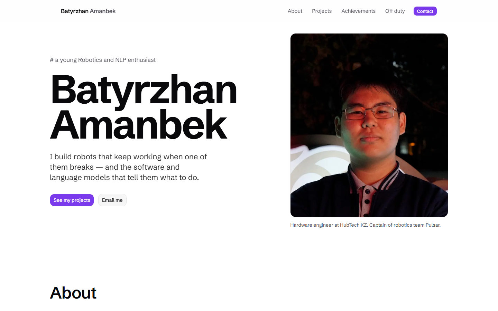
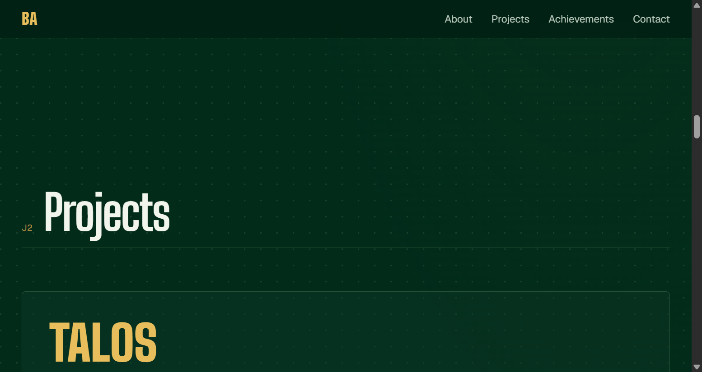
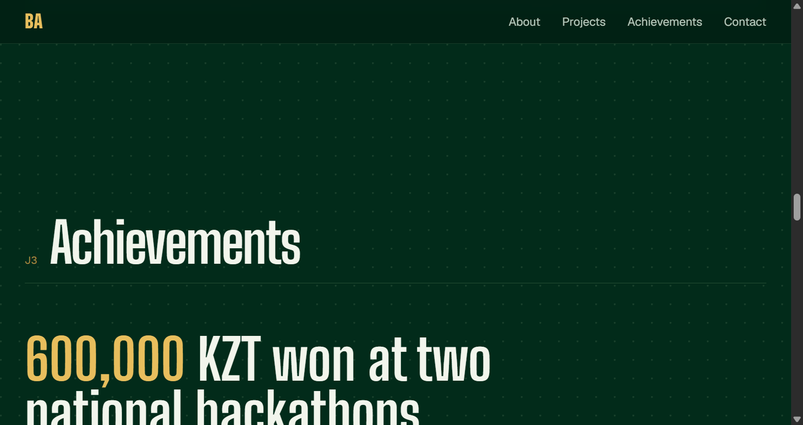
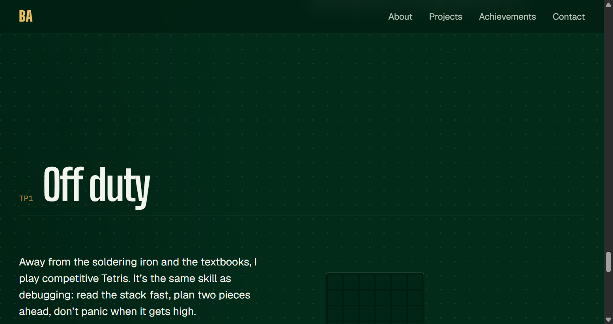

# Batyrzhan Amanbek

**Robotics, hardware and language models.** I'm 16 and in 11th grade at the Bilim-Innovation Lyceum for gifted boys in Kyzylorda, Kazakhstan. I build robots that keep working when one of them breaks, and the software and LLMs that tell them what to do.

This repository is my personal portfolio site.

## What I do

- **Hardware Engineer at HubTech KZ.** Designing and soldering the electronics side of real products: boards, wiring, sensors, and the bring-up that makes them talk.
- **Captain of robotics team Pulsar** ([@pulsar_ftc](https://instagram.com/pulsar_ftc/)). Leading a FIRST Tech Challenge team: splitting the build, keeping the code honest and getting the robot to the field on time.
- **Focused on** embedded systems, LLMs and swarm robotics.

## Projects

- **[TALOS](https://github.com/batryzhan/talos)** (Target-Agent Learning & Operational System). A system that lets a group of mobile robots split up work and keep going when one of them fails. Robots bid for tasks in an auction, and when one drops out the rest re-plan in seconds. Tested in simulated factory, mine and wildfire scenarios.
- **[Pulsar Triage](https://github.com/BAITC-Hacks/hack-02e066fd-pulsar/)**. An LLM assistant that sorts Grand Mobile players' support requests, sets their priority and drafts replies that administrators review before sending.

## Achievements

- 1st place, **Decentrathon 6.0**, across 19 regions of Kazakhstan (500,000 KZT)
- 1st place, **National Hackathon by KazAtomProm 2026** (100,000 KZT)
- Finalist, **World Robot Olympiad 2026**, national stage, top 20 in Kazakhstan
- 2nd place and a university education grant, **CP Open Cup III (2025)**
- Programming Mastery Award, **Central Asian FIRST Championship**

## Off duty

When I'm not engineering or studying I play Tetris on [TETR.IO](https://ch.tetr.io/u/batryzhan), and there's almost always something playing on Spotify. The site has a little animation of Tetris pieces stacking into my name.

## Get in touch

- Email: [batryzhan@gmail.com](mailto:batryzhan@gmail.com)
- GitHub: [batryzhan](https://github.com/batryzhan/)
- LinkedIn: [in/batryzhan](https://linkedin.com/in/batryzhan/)
- Telegram: [@batryzhan](https://t.me/batryzhan/)
- Instagram: [@batryzhan](https://instagram.com/batryzhan/)

## About the site

One page, built with Vite, React 19, TypeScript and Tailwind CSS v4. All text and links live in `src/content.ts`.

### SEO

The build adds a canonical link, Open Graph and Twitter tags pointing at the social card (`public/og-image.png`), schema.org `Person` and `WebSite` JSON-LD, `robots.txt` and `sitemap.xml`. They use the production address `https://batryzhan.online` (set in `vite-seo.ts`); override it with `SITE_URL=https://other.example npm run build`. After deploying, submit `/sitemap.xml` in Google Search Console.
